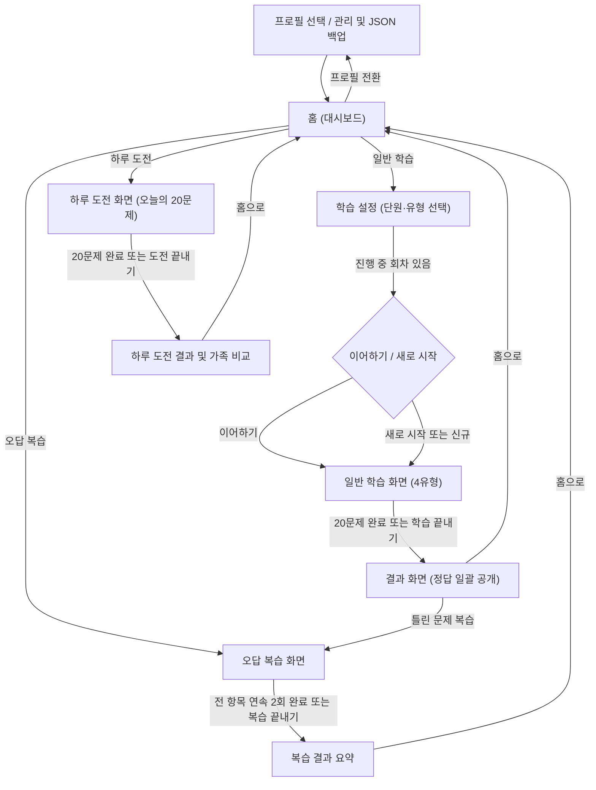

# 화면 설계서

작성일: 2026-11-21 | 대상 기기: 모바일 터치(iOS Safari · Android Chrome) + PC 브라우저(Chrome · Edge)

---

## 1. 설계 원칙 및 반응형 기준

| 항목 | 설계 기준 |
|---|---|
| **레이아웃 구조** | 모바일 우선 단일 컬럼 카드 레이아웃(`max-width: 560px` 중앙 정렬) 기반. PC 태블릿(`768px` 이상)에서는 여백 확보 및 결과/단원 목록의 2열 배치만 확장해 조작 동선을 동일하게 유지한다. |
| **터치 및 포인터 조작** | 모든 버튼·보기 카드는 최소 **44×44px** 이상 터치 영역을 확보한다. 필기 캔버스는 `PointerEvent` 통합 처리 및 `touch-action: none`을 적용해 모바일 터치 중 화면 스크롤·확대를 방지한다. |
| **색각 및 가독성** | 정오(녹색 + 체크 아이콘 + `"정답"`), 오답(적색 + X 아이콘 + `"오답"`), 쌍 불일치(주황색 + 경고 아이콘 + `"개별 존재하나 쌍 불일치"`)처럼 **색상·아이콘·텍스트를 항상 병기**한다. |
| **오프라인/로컬 저장** | 1차 버전은 서버 없이 `LocalStorage`에 프로필·회차·복습·누적 출제·하루 도전 기록을 자동 저장하며, JSON 파일 백업/복원을 제공한다. |

---

## 2. 전체 화면 정보 구조(IA) 및 흐름도

---

## 3. 화면별 상세 설계

### 3.1 프로필 선택 / 관리 및 JSON 백업 화면

1차 MVP의 진입 관문이자 기기 내 가족 전환 화면이다(활성 프로필이 이미 있으면 홈에서 상단 프로필 배지를 눌러 이동).

- **프로필 목록 카드**: 등록된 가족 프로필(아바타 아이콘·색상 배지, 이름, 최근 학습일, 대기 중인 오답 복습 건수) 표시. 카드 탭 시 즉시 해당 프로필로 전환되어 홈으로 이동.
- **프로필 추가 / 수정 / 삭제**:
  - 필수 입력: 이름(1~12자), 아바타 아이콘/컬러 선택.
  - 삭제 시 2단계 확인 모달(`"○○님의 모든 학습·복습 기록이 삭제됩니다"`).
- **데이터 백업 / 복원 (JSON)**:
  - `전체 데이터 내보내기(JSON)`: 현재 기기의 모든 프로필·회차·복습·누적 출제·하루 도전 데이터를 `hanja-study-backup-YYYYMMDD.json`으로 다운로드.
  - `백업 파일 불러오기(JSON)`: 파일 선택 시 스키마/버전 검사 후 `"현재 기기 데이터를 덮어쓸까요?"` 확인 후 복원.
  - 하단에 `2차 업데이트 안내: 추후 로그인 기반 클라우드 동기화 및 주간 순위 지원 예정` 안내 배지(비활성).

### 3.2 홈 (대시보드) 화면

- **상단 헤더**: 현재 활성 프로필(아바타 + 이름) 버튼(탭 시 프로필 전환 화면), 백업 상태/설정 아이콘.
- **3대 학습 진입 카드**:
  1. **일반 학습**: 단원·유형을 고르고 20문제를 푸는 기본 모드. 진행 중인 일반 학습 회차가 있으면 `"진행 중 회차 있음 (N/20)"` 배지 표시.
  2. **오답 복습**: 현재 프로필의 미완료 복습 대기 건수 배지 표시(예: `"복습 대기 7개"`). 대기 항목이 `0`개이면 `"복습할 오답이 없어요"` 안내 및 비활성화.
  3. **하루 도전**: 오늘 날짜(`YYYY-MM-DD`) 기준 20문제 일일 도전 카드. 오늘 도전 완료 시 `"오늘 완료 · 34/40점"` 배지 및 가족 비교 바로가기 표시.
- **개인 학습 요약 바**: 누적 학습 한자 수, 오늘 푼 문항 수, 복습 완료 누적 수.

### 3.3 학습 설정 화면 (단원 및 문제 유형 선택)

- **단원 선택 영역**:
  - 천재교과서 2022 개정 중학 한문 1~20단원 체크박스 리스트(대단원 접기/펼치기, `전체 선택` / `선택 해제`).
  - 각 단원 행에 `단원 번호 · 단원명 · 수록 한자 수(예: 23자)` 및 `쓰기 검증 완료 수` 요약 표시.
  - 선택된 범위의 총 고유 한자 수 실시간 집계 표시(20자 미만일 경우 `"20자 미만 범위: 전수 출제 후 적은 횟수 순으로 반복해 20문제를 채웁니다"` 안내 문구 표시).
- **문제 유형 선택 영역 (다중 선택)**:
  - ① `한자 → 뜻·음 (객관식)`
  - ② `한자 → 뜻·음 (주관식)`
  - ③ `뜻·음 → 한자 (객관식)`
  - ④ `한자 쓰기 (필순·획 보정)`
  - 선택 개수에 따른 **자동 문항 배분 미리보기** 표시(예: 3개 선택 시 `7 · 7 · 6문제 무작위 배분 및 순서 섞기`).
- **출제 불가 사전 안내 및 `'시작'` 버튼 비활성화 규칙**:
  - 단원 0개 선택 또는 유형 0개 선택 시 `'시작'` 버튼 비활성화.
  - 선택한 유형 중 **출제 가능 한자가 0자**이거나(예: `strokeStatus === "verified"` 한자가 0자인 상태에서 쓰기만 선택), **4지선다 보기 구성이 불가능**한 경우 상단 경고 배너로 구체적 불가 사유를 안내하고 `'시작'` 버튼을 비활성화한다.
  - 여러 유형을 섞었을 때 일부 유형만 부족하면 불가 유형 제외·가능 유형 대체 안내 또는 시작 전 확인 제공.
- **이어하기 분기**: 동일 프로필에 진행 중 일반 학습 회차가 남아 있으면 `'시작'` 시 `"진행 중인 학습(N/20)이 있습니다"` 모달을 띄워 **[이어하기]** / **[기존 회차 끝내고 새로 시작]** 선택을 받는다.

### 3.4 일반 학습 화면 (4유형 공통 + 유형별 인터페이스)

#### 공통 상단 상태 바 & 하단 액션
- **상단 바**:
  - 좌측: `[학습 끝내기]` 버튼(탭 시 중도 종료 확인 모달: `"현재 표시된 미제출 문항은 '중도 이탈'(0점, 복습 미등록)로 처리되고 완료한 문항만 결과에 공개됩니다"`).
  - 중앙: 진행 표시(`12 / 20`) 및 진행 막대.
  - 우측: **실시간 누적 점수**(`18점`, 2점 단위 즉시 가산) + 직전 문항 정오 배지(`✓ 직전 +2점` 또는 `✕ 직전 0점`).
- **정답 공개 통제**:
  - 일반 제출 직후에는 상단/피드백 영역에 **정오 여부(정답/오답)와 점수 변화만 즉시 표시**하고, 틀렸을 때의 **실제 정답 텍스트·한자는 회차 종료 후 결과 화면에서 일괄 공개**한다.
  - 단, 복수 독음 쌍 불일치 오답일 때는 입력/선택 칸에 **주황 경고(`개별 존재하나 쌍 불일치`)**를 즉시 표시한다(올바른 쌍 조합 안내는 결과 화면에서 일괄 제공).
- **공통 하단 액션 바**:
  - 좌측: **[모르겠어요]** 버튼 — 입력/선택 여부와 무관하게 **항상 활성화**. 클릭 시 즉시 0점 확정, 오답 복습 등록, **예외적으로 해당 문항의 정답을 즉시 화면에 공개**(모달/인라인 카드)한 뒤 `[다음 문제]` 버튼으로 넘어간다.
  - 우측: **[제출]** 버튼 — 유형별 필수 입력 조건 충족 시에만 활성화. 즉시 재시도는 불가하다.

#### 유형별 문제 영역 레이아웃

| 유형 | 문제 제시부 | 사용자 입력/선택 영역 | 제출 버튼 활성화 조건 |
|---|---|---|---|
| **① 한자 → 뜻·음 (객관식)** | 중앙 대형 한자 카드 (예: `樂`) | - **뜻 4지선다** 버튼 4개 - **음 4지선다** 버튼 4개 (각 영역 1개씩 선택, 제출 전 변경 가능) | 뜻 1개 **AND** 음 1개 모두 선택 시 |
| **② 한자 → 뜻·음 (주관식)** | 중앙 대형 한자 카드 (예: `漢`) | - **뜻 입력 칸** (`원문 뜻 입력`) - **음 입력 칸** (`음 입력`) (가상 키보드 가림 방지 자동 스크롤) | 뜻 칸 **AND** 음 칸 모두 공백 제외 1자 이상 입력 시 |
| **③ 뜻·음 → 한자 (객관식)** | 교과서 모든 뜻·음 쌍 구분 배지 (예: `즐겁다 · 락` / `노래 · 악`) | - **한자 4지선다** 카드 4개(2×2 격자, 대형 한자 글리프, 정답 한자 1개만 포함) | 한자 보기 1개 선택 시(미선택 시 비활성화) |
| **④ 한자 쓰기 (획 보정)** | 교과서 모든 뜻·음 쌍 + **목표 한자 1자 특정용 힌트 칩**(`부수: 木 · 총획: 15획`) | - 정사각 1:1 필기 캔버스(십자 안내선, `renderMode`별 `fill`/`stroke` 렌더링) - 획 번호 진행 표시(`3 / 15획`) + `처음부터 다시` | 모든 획을 순서대로 통과해 마지막 획 완료 시 자동 채점(2점) 또는 완료 확정 |

#### ④ 한자 쓰기 캔버스 상세 상태
1. **매 획 판정 (`pointerup`)**: 사용자가 한 획을 긋고 손을 떼면 즉시 방향·시작점·끝점·궤적·변별 규칙(`土/士`, `日/曰`)을 판정한다.
2. **통과**: 거친 입력 궤적을 즉시 선명한 정자 벡터 획으로 스냅·고정하고 다음 획으로 진행한다.
3. **실패 (1~2회)**: 잘못된 획은 정자로 바꿔주지 않고 지우며, **직전까지 성공한 획들은 그대로 유지**한 채 재입력 토스트(`"획 방향 또는 위치를 확인해 다시 써 보세요 (1/3)"`)를 띄운다.
4. **3회 연속 실패 시 점선 가이드**: 동일 획에서 3회 연속 실패하면 **해당 획에 한해 캔버스 위에 점선 가이드(시작점·진행선)를 자동 표시**하고, 해당 문항 기록에 `usedStrokeGuide: true`를 남긴다(직접 다시 쓰기를 이어가 완주하면 2점 부여, 포기 시 `'모르겠어요'` 사용).

### 3.5 오답 복습 화면

- **상단 바**: `[복습 끝내기]`(중도 종료 가능), 남은 복습 대기 항목 수(`대기 5개`), 현재 문항의 연속 정답 진행 배지(`연속 정답: 0/2` → `1/2` → `완료!`).
- **출제 규칙 시각화**:
  - 대기열은 FIFO + 연속 정답 횟수가 적은 순으로 선택되며 직전 항목은 연속 출제하지 않는다.
  - 원래 틀렸던 문제 형식(객관식/주관식/뜻·음→한자/쓰기)과 정답 쌍을 그대로 출제한다(객관식 오답 보기·순서는 매번 새로 섞음).
  - **1개 항목 잔여 시 삽입 문항**: 대기 항목이 1개만 남았을 때 사이에 끼워 넣는 같은 단원(없으면 타 단원) 다른 한자 문제에는 상단에 **`[연습 삽입 문제]`** 배지를 표시해, 이 문제를 맞혀도 남은 복습 항목의 연속 정답 횟수에 합산되지 않음을 명확히 알린다(단, 삽입 문제를 틀리면 복습 대기열에 새로 편입됨을 안내).
- **완료 처리**: 대기 중인 모든 항목이 한 회차 내에서 연속 2회 정답을 달성하면 축하 배너와 함께 복습 회차를 자동 종료한다.

### 3.6 결과 화면

일반 학습(또는 중도 종료) 종료 후 이동하며, 학습 결과의 모든 세부 정보를 투명하게 공개한다.

1. **요약 점수 카드**:
   - 획득 총점 (예: `32 / 40점`) 및 소요 시간.
   - **두 가지 정답률 병기 카드**:
     - **문항 정답률**: `정답 문항 수 / 확정 응답 수(일반 제출 + '모르겠어요')` (예: `80% (16/20)`, `'중도 이탈' 0건 제외`)
     - **뜻·음 개별 정답률**: `뜻 정답률 85% · 음 정답률 90%` (`일반 제출 기준`, `'모르겠어요' N건 · '중도 이탈' M건 별도 표기`)
2. **쌍 불일치 주황 경고 카드 (해당 오답 존재 시 상단 강조)**:
   - 주황 배경 + 경고 아이콘(`⚠`)으로 **`개별 존재하나 쌍 불일치`** 사유를 명시하고, 사용자가 입력/선택한 조합(예: `樂 — 즐겁다 · 악`)과 함께 해당 한자의 **올바른 뜻·음 쌍 조합 전체**(`즐겁다 · 락` / `노래 · 악`)를 대조 카드로 안내한다.
3. **문항별 정답 일괄 공개 리스트**:
   - 회차 내 완료한 문항(중도 종료 시 완료 문항 + `'중도 이탈'` 문항, 미표시 문항 제외)을 번호순으로 나열한다.
   - 각 행에 문제 유형, 제시 한자/뜻·음, 상태 배지(`정답` / `오답` / `쌍 불일치` / `모르겠어요` / `중도 이탈`), **내 답안 vs 교과서 정답(두음법칙 허용 음 포함)**, 쓰기 점선 가이드 사용 여부를 표시한다.
4. **하단 액션 버튼**: `[오답 복습 바로 시작 (N개)]` (복습 등록 항목 존재 시), `[같은 범위 다시 풀기]`, `[홈으로]`.

### 3.7 하루 도전 화면

- **진입 화면**: 오늘 날짜(`YYYY-MM-DD`)의 고정 시드로 생성된 `오늘의 20문제` 안내(오늘 이미 완료한 프로필은 재도전 시 연습 기록 처리 안내 또는 결과 비교 뷰 직행).
- **문제 풀이 화면**: 일반 학습 화면과 동일한 4유형 UI 및 채점·즉시 정오/점수 표시 규칙을 따르되, 상단에 `하루 도전` 배지와 경과 타이머(참고·동점 비교용)를 표시한다.
- **하루 도전 결과 및 기기 내 가족 비교**:
  - 오늘의 내 점수, 두 가지 정답률, 소요 시간, 문항별 정답 일괄 공개.
  - **기기 내 가족 프로필 비교표**: 같은 날 하루 도전을 완료한 기기 내 다른 가족 프로필의 순위(점수 우선 → 소요 시간 짧은 순)를 나란히 표시한다.
  - 2차 서버 연동 시 주간 누적 순위표 탭이 추가될 수 있도록 상단 탭 영역을 예약한다.
